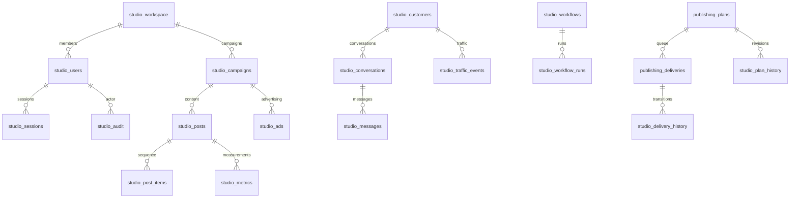
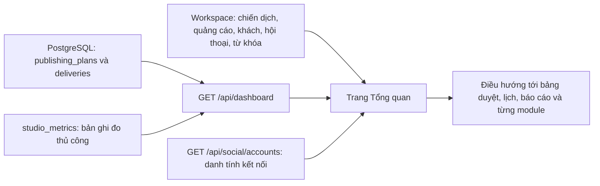

# Database và phân quyền Omni Studio

Một workspace chung (id 1), nhiều thành viên có vai trò. Chưa triển khai cách ly nhiều doanh nghiệp/tenant. PostgreSQL 18 trên máy hiện tại; schema dùng được trên PostgreSQL 17+. Prisma 6.19.3 cung cấp model quan hệ và các query đọc có `select`; pg giữ các transaction/worker `SKIP LOCKED` hiện có. SQL migration là nguồn chuẩn; Prisma introspection không thay đổi dữ liệu.

## Ánh xạ màn hình và database

| Màn hình/chức năng                  | Bảng dữ liệu chính                                                                                | API                                                          |
| ----------------------------------- | ------------------------------------------------------------------------------------------------- | ------------------------------------------------------------ |
| Đăng nhập, thành viên, quyền        | studio_users, studio_sessions, studio_workspace                                                   | /api/auth/*                                                  |
| Liên kết, tài khoản, kênh           | studio_social_accounts, studio_accounts, studio_channels                                          | /api/social/_, /api/records/_                                |
| Chiến dịch, ngân sách               | studio_campaigns, studio_ads                                                                      | /api/workspace, /api/records/campaigns,ads                   |
| Bài viết, chuỗi, ảnh                | studio_posts, studio_post_items, studio_media                                                     | /api/workspace, /api/records/posts,media                     |
| Lịch đăng, lặp, trạng thái          | publishing_plans, publishing_deliveries, studio_plan_history, studio_delivery_history             | /api/publishing/*                                            |
| Chat, phản hồi                      | studio_conversations, studio_messages                                                             | /api/workspace, /api/records/conversations                   |
| Khách hàng, traffic                 | studio_customers, studio_traffic_events                                                           | /api/records/customers,traffic                               |
| Tổng quan, hiệu suất, thông tin bài | studio_metrics, publishing_plans/deliveries và các bảng workspace                                 | /api/dashboard, /api/records/metrics,reports                 |
| AI Analysis theo kỳ                 | ai_import_batches, ai_import_rows, ai_analysis_runs                                               | /api/ai/imports, /api/ai/analyses                            |
| SEO, đối thủ, kiểm tra thứ hạng     | studio_keywords, studio_competitors, studio_rank_checks                                           | /api/workspace, /api/records/keywords,competitors,rankChecks |
| Workflow/RPA, lịch sử chạy          | studio_workflows, studio_workflow_runs                                                            | /api/records/workflows,workflowRuns                          |
| Thông báo duyệt qua RPA             | studio_automation_messages, studio_rpa_runs                                                       | /api/automation/status, /api/publishing/approvals            |
| Nhãn, thông báo, cấu hình, duyệt    | studio_tags, studio_notifications, studio_settings, studio_approvals                              | /api/records/*                                               |
| Lịch sử thay đổi, khôi phục         | studio_audit, studio_snapshot_history, omni_workspace (compatibility snapshot), studio_migrations | /api/history, /api/snapshots                                 |

Mỗi nhóm dữ liệu có bảng riêng, khóa chính `(workspace_id,id)`, FK và index cho quan hệ, cột typed cho trường truy vấn (numeric cho ngân sách, timestamptz cho mốc thời gian) và `payload JSONB` giữ các thuộc tính UI mở rộng. Các bản ghi xóa được soft-delete. Bản sao trước khi sửa và audit before/after giữ được trạng thái cũ. API GET workspace ghép bảng quan hệ; PUT ghi tất cả bảng và compatibility snapshot trong một transaction có version lock. Tải lại không ghi dữ liệu rỗng vào DB và không tự xóa mẫu khỏi dữ liệu server.

## AI Analysis theo kỳ

Migration 012 bổ sung batch nhập chỉ số, hàng số liệu từng Facebook post và lịch sử phân tích AI; không dùng `studio_metrics` cũ làm nguồn mặc định vì các bản ghi cũ không bảo đảm cùng định nghĩa chỉ số/kỳ đo. Batch giữ Page ID, kỳ, múi giờ, nguồn dữ liệu, thời gian/người nhập và phiên bản định nghĩa. Mỗi hàng giữ provider post ID, các số đếm trong kỳ, text tùy chọn và ràng buộc chống trùng/chồng kỳ. Không quy đổi snapshot lifetime thành số liệu trong kỳ. Backend tính KPI/facts có ID, tỷ lệ mẫu số thiếu/0 là `null` với lý do. `reach` chỉ là reach theo bài, không phải Page unique reach.

`ai_analysis_runs` giữ actor, batch/snapshot đầu vào đã lọc, hash và phiên bản prompt/schema/model, output đã kiểm tra fact ID, trạng thái, usage/chi phí hoặc phần usage chưa xác định. Cache theo hash + version; giới hạn và reservation được lưu bền vững để tránh yêu cầu đồng thời vượt ngân sách. Admin/Manager nhập và gọi AI; phiên đăng nhập khác chỉ đọc. Mutation vẫn qua session/CSRF và SQL parameterized. Text bài được coi là dữ liệu không tin cậy; credential, email, cookie và token không nằm trong payload AI. Provider chỉ giải thích dữ liệu được backend tính; không thực thi tool hoặc thao tác đăng bài.

## Tổng quan vận hành

`GET /api/dashboard?period=week|month` chỉ đọc: đếm trạng thái kế hoạch, lấy tối đa 5 bài pending và 5 lượt queued sắp đến trong 7 ngày thuộc phiên bản hiện tại. Lượt published trong 7/30 ngày tính cả delivery của phiên bản cũ vì đó vẫn là kết quả đăng thật; trạng thái failed/unknown cần kiểm tra chỉ tính phiên bản hiện tại. `studio_metrics` có `measuredAt` trong cùng kỳ được cộng vào số liệu ghi nhận. Bài đăng trực tiếp trên Page không nằm trong delivery nên không được cộng. Số liệu reach/clicks/spend là bản ghi do người dùng nhập; chưa có đồng bộ insight tự động. Tài khoản đã kết nối lấy từ Social API đã xác minh; các module nội bộ lấy từ workspace đã tải. Frontend làm mới mỗi 30 giây hoặc khi kế hoạch thay đổi, không bật worker hay gửi bài. Khi API lỗi hiển thị lỗi, không biến dữ liệu thiếu thành số 0. Vai trò chỉ xem đọc được tổng quan, còn hành động duyệt và đăng vẫn qua API được bảo vệ riêng.

## Quyền và phiên

| Vai trò | Quyền                                                                                                                 |
| ------- | --------------------------------------------------------------------------------------------------------------------- |
| admin   | Toàn bộ dữ liệu trong workspace, tạo/khóa thành viên, đổi vai trò, khôi phục snapshot                                 |
| manager | Quản lý dữ liệu, liên kết và đăng/lên lịch, hủy lịch, xem snapshot; không quản lý người dùng                          |
| editor  | Biên tập dữ liệu nội bộ và bài nháp/gửi duyệt; không thay đổi danh tính kết nối, không đăng hoặc thay đổi lịch đã tạo |
| viewer  | Xem dữ liệu; không thực hiện mutation                                                                                 |

Mật khẩu scrypt + salt, không lưu plaintext. Session 12 giờ lưu hash token trong PostgreSQL; cookie HttpOnly/SameSite=Strict, Secure ở production. Mutation yêu cầu CSRF header đối chiếu hash phiên và kiểm tra Origin. Login/bootstrap có giới hạn lần thử theo IP. Chỉ có thể bootstrap quản trị viên khi bảng users rỗng, kiểm tra atomically bằng advisory lock; phải giữ một admin hoạt động. Thay đổi mật khẩu/quyền/khóa thu hồi các phiên. API mặc định bắt đăng nhập, kể cả social/publishing/legacy publish; health và tài liệu công khai, OAuth callback được kiểm tra bằng state/cookie của social adapter. `createApp({authentication:false})` chỉ là dependency injection cho test mock, entry point luôn dùng mặc định bật auth.

## Chuyển đổi, backup và kiểm thử

1. `npm run db:backup`: pg_dump custom trong BE/.data/backups (gitignored). Có thể cấu hình PG_DUMP_PATH. Credential truyền qua environment cho process, không in command chứa mật khẩu.
2. `npm run db:migrate`: ledger checksum, advisory lock chống chạy đồng thời; migration đã áp dụng không sửa. 001–006 là mở rộng, không reset database.
3. Backfill workspace cũ tách khỏi DDL, chỉ chạy một lần, không overwrite row có sẵn; giữ nguyên snapshot/version ban đầu trong studio_snapshot_history.
4. `npm run db:generate`, `npm run db:validate`: kiểm tra Prisma. Khi thay SQL schema, `npm run db:introspect` rồi generate; không dùng db push/migrate reset/migrate dev trên database người dùng.
5. `npm test`: mock/regression. `npm run test:database`: tạo schema `omni_test_<random>`, kiểm tra migration thật, auth/CSRF/RBAC/409/history/session và lịch sau restart; provider mock, schema thử được dọn cuối test.

Rollback dùng phiên bản ứng dụng tương thích hoặc migration tiến tiếp. Không drop các bảng có dữ liệu để rollback. Khôi phục snapshot quản trị yêu cầu admin + version hiện tại; không sửa hàng đợi hay tự đăng bài. Bản backup gốc trước đợt chuyển đổi này nằm trong BE/.data/pre-schema-upgrade-*.json. Không thể tái tạo các hoạt động đã mất trước khi audit được cài; có thể nhập bản ghi localStorage còn tồn tại bằng nút trên Dữ liệu chức năng, merge theo id và giữ bản DB khi trùng id.

Facebook là adapter thật duy nhất. Metadata đã xác minh được ghi DB; Page token trong BE/.env/vault AES-GCM riêng, không vào session browser/workspace/audit. Các bảng workflow, chat, analytics, SERP và adapter khác lưu dữ liệu/yêu cầu/nhật ký nội bộ; schema không tự tạo quyền Meta, không tự thu thập chỉ số hoặc gửi chat/chạy robot. UI không sinh thứ hạng và trend giả: thiếu nguồn đo sẽ hiện chờ dữ liệu. Worker đăng thật vẫn là tiến trình riêng opt-in, không được bật bởi migration hay test.

Đăng ngay có receipt studio_publish_requests bền vững theo UUID/fingerprint. Published trả lại kết quả cũ; pending/unknown sau restart không tự gửi lại. CSP cho script chỉ self; style unsafe-inline là nợ tương thích cho các biểu đồ React có inline style, không cho phép script inline/eval. Dùng database user có quyền DML cho runtime, tài khoản migration riêng có quyền DDL; không triển khai public bằng user postgres.

Admin có thể đặt lại mật khẩu thành viên trong Thành viên & phân quyền, cần xác nhận mật khẩu admin hiện tại; tất cả phiên của thành viên được thu hồi. Người dùng tự đổi mật khẩu từ menu Đổi mật khẩu.

## Duyệt lịch và giữ lịch sử lượt đăng

Migration 007 thêm pending và cơ chế hủy bài chưa duyệt quá giờ. Migration 008 thêm publishing_deliveries.plan_version; sửa/hủy/gửi lại giữ nguyên lượt cũ và lịch sử. Unique theo plan/account/item/occurrence/version; worker claim phiên bản hiện tại và kiểm tra bài nối tiếp trong cùng phiên bản. Pending không tạo delivery; approve chỉ Admin/Manager, yêu cầu giờ tương lai và version hiện tại. Resubmit cancelled chỉ về pending, phải duyệt lại. Sweep hủy hoạt động độc lập với publishing worker.

Migration 013 mở `studio_rpa_runs.kind` cho `approval_read`, lưu `plan_id`, `plan_version`, `result` JSONB và `read_at`. Unique theo ID/phiên bản bảo đảm một job đọc UI cho mỗi lần gửi duyệt; foreign key xóa kèm kết quả RPA khi Admin xóa vĩnh viễn bài. `studio_automation_messages` tiếp tục là outbox theo người nhận/phiên bản/loại thư; n8n chỉ claim khi job đọc thành công, và kiểm tra lại trạng thái, phiên bản, giờ đăng, người nhận trước SMTP. Trạng thái `sending` không tự retry khi kết quả SMTP chưa rõ.
