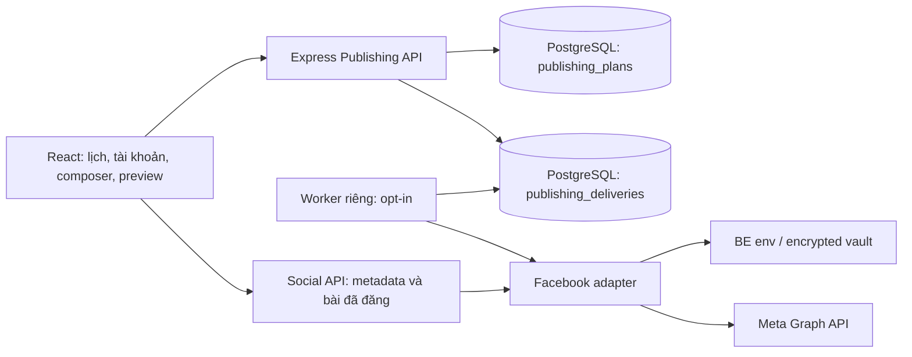

# ADR draft: Kế hoạch đăng nội dung đa tài khoản bằng PostgreSQL

**Date**: 2026-10-12  
**Status**: proposed — bản thảo chờ người dùng duyệt trước khi đưa vào `docs/adr/`  
**Deciders**: Chủ dự án và Codex

## Context

Workspace đang lưu snapshot JSONB; trình soạn cũ chỉ đăng một Facebook Page, lịch chỉ cấu hình và không có hàng đợi bền vững. Mẫu UI yêu cầu nhiều tài khoản, chuỗi nội dung, lịch theo giờ, lặp lại và theo dõi kết quả. Cần giữ dữ liệu đang có, không đưa token vào browser hoặc snapshot và không gửi lại bài khi chưa rõ kết quả provider.

## Decision

Giữ modular monolith Express và React hiện tại; thêm module Publishing với hai bảng quan hệ PostgreSQL, API REST và worker riêng. Lưu bản soạn/kế hoạch trong `publishing_plans`; materialize từng tài khoản × nội dung × lượt lặp thành `publishing_deliveries` trong cùng transaction. Cấu hình token vẫn nằm trong `.env` hoặc vault AES-256-GCM của module Social.

## Data model

- `publishing_plans`: UUID, version, JSONB payload có name, accountIds, items, timezone, scheduledAt, repeat/count; status draft/scheduled/cancelled; created/updated timestamps. JSONB cho cấu trúc bản soạn, bảng quan hệ cho khóa ngoại và vòng đời.
- `publishing_deliveries`: UUID, FK plan, account ID tham chiếu registry Social, thứ tự nội dung, lượt lặp, due_at TIMESTAMPTZ, trạng thái, provider_post_id, thông báo lỗi an toàn, started/finished timestamps. Unique(plan, account, index, occurrence) và partial index cho queued/due_at.
- `omni_workspace` được giữ nguyên. Không chuyển hoặc xóa snapshot/bài thật đã có. Khi DB chưa dùng được, bản soạn cục bộ vẫn dùng schema hiện có; chúng không trở thành delivery tự động.
- Không lưu token ở hai bảng mới. Account ID là khóa trong registry token hiện tại, chưa có FK tới bảng tài khoản quan hệ; tách bảng account/vault đa tenant là công việc cần làm trước production.

## API and state transitions

| Endpoint                                    | Hành vi                                                                                              |
| ------------------------------------------- | ---------------------------------------------------------------------------------------------------- |
| GET /api/publishing/status                  | ready của DB/bảng và cấu hình worker; không chứng minh tiến trình worker sống                        |
| GET /api/publishing/plans?limit=50&offset=0 | Kế hoạch + kết quả; nextOffset cho trang sau                                                         |
| POST /api/publishing/plans                  | 201 + Location; draft lưu soạn, scheduled tạo các delivery; UUID client chống tạo trùng cùng payload |
| PUT /api/publishing/plans/:id               | Toàn bộ bản soạn + version; 409 nếu stale hoặc đã bắt đầu đăng                                       |
| POST /api/publishing/plans/:id/cancel       | version; hủy queued, không thu hồi running/published                                                 |

400: validation; 403: account chưa liên kết; 404: kế hoạch không có; 409: phiên bản/ID/trạng thái xung đột; 422: loại nội dung scheduled chưa hỗ trợ; 503: DB/migration chưa sẵn sàng. SQL parameterized; lỗi không trả credential/SQL/stack.

Worker chọn due delivery bằng `FOR UPDATE OF p, d SKIP LOCKED`, cập nhật running rồi commit trước khi gọi provider. Nội dung nối tiếp đợi các nội dung trước trong cùng account/occurrence published. Provider ID được lưu riêng từng target. Lượt running quá 2 phút thành unknown; failed/unknown chặn các nội dung tiếp theo trong cùng chuỗi. Lượt lặp tiếp theo là occurrence độc lập.

Không tuyên bố exactly-once với Meta: một POST có thể thành công ở provider nhưng timeout/mất kết nối DB. Không tự retry unknown. Người dùng phải kiểm tra Page và tạo kế hoạch mới nếu thật sự chưa đăng. Hủy có thể đua với lượt đã được worker claim; UI nói rõ running không được thu hồi.

## UI and supported scope

- Lịch ngày/tuần/tháng, các ô theo giờ; GMT+7, GMT+8 và UTC (các zone cố định, không DST). Đổi zone chỉ đổi hiển thị, giữ nguyên instant. Tuần/tháng có cuộn ngang trên mobile.
- Tài khoản thật, chọn nhiều Page đã xác minh. Preview Facebook/Instagram/LinkedIn/X/TikTok/YouTube/Google/Zalo không đồng nghĩa có quyền đăng.
- Tối đa 10 nội dung, mỗi nội dung có ảnh hợp lệ ≤1 MB, đếm ký tự và độ trễ; lặp ngày/tuần hữu hạn tối đa 30 lượt. Giới hạn bộ đếm là preset để soạn, chưa phải xác minh toàn bộ hạn mức API từng nền tảng.
- Facebook là adapter đang thực thi. Chuỗi scheduled là các bài độc lập nối tiếp trên Page. Reply/bình luận lưu draft; scheduled reply trả 422 cho tới khi có adapter engagement và quyền được xác minh. Preview Markdown chỉ bản soạn; Facebook /feed gửi văn bản nguyên bản.
- Đăng ngay bài chính có xác nhận cho nhiều Page, ghi kết quả từng target; không áp dụng lịch/lặp lại và không tự gửi chuỗi.
- Worker mặc định tắt và chạy bằng lệnh riêng; lưu lịch không chứng minh worker đang chạy. Không bật workflow n8n hoặc đăng thật trong test.

## Alternatives Considered

### Chỉ dùng snapshot JSONB/localStorage

- **Pros**: ít thay đổi, tương thích bản soạn cũ.
- **Cons**: tranh chấp khi worker ghi nhiều lượt, không có khóa/index hàng đợi độc lập, browser đóng thì không chạy lịch.
- **Why not**: dùng cho fallback bản soạn, không dùng làm job queue.

### Redis/BullMQ ngay từ đầu

- **Pros**: nhiều tính năng queue, concurrency và retry sẵn có.
- **Cons**: thêm dịch vụ vận hành, đồng bộ trạng thái giữa DB và queue; retry không an toàn với provider không idempotent.
- **Why not**: PostgreSQL đang là stack yêu cầu, đủ cho prototype và single workspace; có thể thay claim layer khi lưu lượng tăng.

### n8n làm nguồn trạng thái đăng

- **Pros**: điều phối trực quan.
- **Cons**: dữ liệu kế hoạch phân tán, token và lỗi provider cần kiểm soát thêm, workflow mẫu chưa chạy thật.
- **Why not**: giữ nguồn trạng thái ở PostgreSQL. n8n có thể gọi API sau khi có auth và yêu cầu tự động hóa cụ thể.

## Consequences

### Positive

- Kết quả từng tài khoản không ghi đè nhau, trạng thái còn lại sau restart.
- Sửa/hủy có optimistic version và transaction; worker không cần browser mở.
- Tận dụng Express/pg/CSS components, không thêm dependency hay phá dữ liệu cũ.

### Negative

- Cần migration và tiến trình worker riêng; metadata account/token vẫn nằm registry/vault prototype.
- Materialize lịch lặp hữu hạn làm tăng số dòng; tối đa 20 account × 10 item × 30 occurrence mỗi kế hoạch.
- Chưa có DST, scheduler calendar-rule phức tạp, provider rate-limit orchestration hoặc lịch sử retry thủ công.

### Risks

- Provider timeout có thể đã đăng: unknown, không retry tự động; đối chiếu Page.
- Prototype chưa có auth/multi-tenant: chỉ bind loopback; cần login/RBAC/tenant FK, audit log, storage media và key management trước public deployment.
- `.env` thật chưa kết nối DB thành công trong lần kiểm tra migration; test repository là mock, không tuyên bố integration PostgreSQL đạt.
- Reply và các nền tảng chưa có adapter giữ disabled/422 rõ ràng, không tạo tài khoản giả hay báo đã đăng.

## Rollout

1. Sửa DATABASE_URL trong BE/.env; chạy `npm run db:migrate`. Migration idempotent, chỉ tạo bảng/index; không xóa volume/schema cũ.
2. Hai terminal phát triển: `npm run dev:api`, `npm run dev`.
3. Kiểm tra `/api/publishing/status` ready=true; tạo draft và kiểm tra dữ liệu thật.
4. Chỉ khi muốn thực thi lịch, cấu hình PUBLISHING_WORKER_ENABLED=true và chạy `npm run worker:publishing` ở terminal thứ ba. Lệnh này có thể đăng thật các queued job đến hạn.
5. Giữ worker tắt khi kiểm thử giao diện hoặc chưa muốn xuất bản. Dừng worker để dừng nhận lượt mới; lượt đang gửi có thể hoàn thành.
