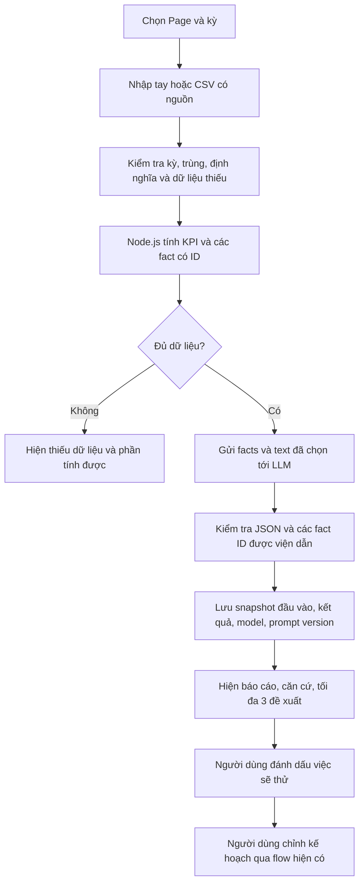

# Kế hoạch AI Analysis vừa sức cho nhóm 2 sinh viên

Ngày đề xuất: 18/10/2026. Đây là kế hoạch, chưa phải chức năng đã triển khai.

## Mục tiêu và phạm vi

Xây một chức năng: phân tích hiệu quả nội dung Facebook theo kỳ, giải thích bằng tiếng Việt,
chỉ ra dữ liệu làm căn cứ và đề xuất tối đa 3 thử nghiệm cho kỳ tiếp theo.

Giả định: 2 sinh viên làm bán thời gian khoảng 10–15 giờ/người/tuần trong 4 tuần. Đây là
ước lượng lập kế hoạch; chốt lại sau tuần đầu. Chưa chọn nhà cung cấp/model hay cam kết giá.

MVP gồm chọn Page và kỳ, nhập số liệu có nguồn, tính KPI bằng code, gọi một LLM qua backend,
kiểm tra kết quả, lưu báo cáo và xem/xuất báo cáo. Chạy theo nút bấm trước.

Chưa làm: huấn luyện model, RAG/vector database, chatbot tổng quát, nhiều nhà cung cấp,
phân loại lead, cảm xúc, dự báo, tối ưu ngân sách tự động hoặc tự đăng bài theo đề xuất AI.

## Dữ liệu và điều kiện phân tích

Source hiện có studio_metrics, studio_reports, Page posts, PostgreSQL/RBAC và Express.
Chưa có collector KPI thật. Ưu tiên module nhập dữ liệu riêng, tái sử dụng UI có sẵn;
không sửa ý nghĩa dữ liệu metrics cũ hoặc coi số liệu cũ đủ điều kiện phân tích mặc nhiên.

- MVP hỗ trợ số liệu theo kỳ cho từng bài: Page ID, provider post ID, periodStart,
  periodEnd, timezone, reach, impressions, interactions; linkClicks là tùy chọn.
- Chốt rõ số interactions bao gồm gì; linkClicks phải là lượt nhấp liên kết cùng kỳ.
- Mỗi batch ghi source, importedAt, người nhập và metricDefinitionVersion.
- Nguồn: nhập tay hoặc CSV từ dữ liệu thực tế được phép sử dụng. Bộ mẫu tổng hợp chỉ dùng
  demo/test, hiển thị nhãn rõ ràng. Chuẩn bị CSV template do nhóm quy định, chưa hỗ trợ mọi
  định dạng xuất của Meta. Có thể phải ánh xạ thủ công từ file nguồn.
- Đầu vào MVP phải là số liệu của đúng kỳ đã chọn. Nếu chỉ có snapshot lifetime/cumulative,
  báo không tương thích; chưa tự cộng hoặc trừ snapshot để suy ra KPI theo kỳ.
- Không cộng reach của nhiều bài thành unique reach của Page. Có thể ghi tổng reach theo
  bài, kèm nhãn không loại trùng người. Chỉ tính tỷ lệ tổng hợp khi mẫu số tương thích.
- Cấm trùng khóa Page + post + kỳ; dữ liệu kỳ chồng lấn không được cộng vào cùng báo cáo.
- Thiếu mẫu số hoặc mẫu số bằng 0: KPI null và ghi thiếu dữ liệu, không thay bằng 0.
- So sánh kỳ trước chỉ khi cùng Page, định nghĩa chỉ số, độ dài kỳ và mức bao phủ tương thích.
  Đây là so sánh mô tả, không chứng minh nguyên nhân. Không khẳng định hiệu quả tốt nhất
  về mặt thống kê khi số bài ít hoặc không có dữ liệu độ bất định.
- Chỉ phân tích chiến dịch nếu có ánh xạ campaignId rõ ràng. MVP mặc định phân tích Page.
- Phân tích nội dung/CTA chỉ khi có text được phép dùng. Không suy ra format hoặc giờ đăng
  tối ưu từ tập dữ liệu thiếu; phân tích ảnh/video và dự báo nằm ngoài MVP.

KPI MVP: interactionRateByReach = interactions / reach × 100 cho từng bài;
linkCTR = linkClicks / impressions × 100 khi có cả hai và định nghĩa tương thích.
Không tính ROI/ROAS/CPL khi chưa có revenue/conversion/lead đáng tin cậy.

## Luồng đề xuất

Backend không thực thi tool/function do model yêu cầu. Nội dung bài là dữ liệu không tin cậy,
không được dùng làm chỉ dẫn. Không gửi cookie, token, email hoặc thông tin khách hàng.
Người dùng thấy rõ dữ liệu nào sẽ gửi ra dịch vụ AI trước khi yêu cầu phân tích.

## Kiến trúc đề xuất

- FE/src/AiAnalysis.jsx: bộ lọc, upload/preview CSV, trạng thái, báo cáo và lịch sử.
- BE/server/ai-analysis.js: router/service, auth, CSRF, giới hạn yêu cầu và điều phối.
- BE/server/ai-metrics.js: chuẩn hóa input, tính KPI và facts, không phụ thuộc LLM.
- BE/server/ai-provider.js: một adapter duy nhất, model cấu hình qua env trên server.
- Migration additive mới theo số tiếp theo còn trống: bảng batch/rows nhập liệu và bảng
  analysis_runs. Kiểm tra ledger trước khi chọn số; không sửa migration đã áp dụng.
- analysis_runs lưu actor, Page/kỳ, input hash, snapshot đã lọc, prompt/schema version,
  model, output, trạng thái, usage và lỗi an toàn. Schema Prisma/tài liệu cập nhật tương ứng.
- API đề xuất: POST /api/ai/imports, POST /api/ai/analyses,
  GET /api/ai/analyses, GET /api/ai/analyses/:id.
- Admin/Manager tạo import/phân tích; người đã đăng nhập đọc theo RBAC hiện có.
  Viewer không tạo request có chi phí. Không vượt qua cơ chế auth/audit hiện tại.

Đầu ra JSON: summary, findings[{factIds, explanation}],
recommendations[{action, rationale, factIds, expectedObservation}], limitations.
Các fact ID phải thuộc input. Frontend lấy số hiển thị từ facts backend; không coi số do
LLM viết trong câu là nguồn chuẩn. Kiểm tra schema không bảo đảm kết luận đúng, vẫn cần eval.

Giới hạn đề xuất: tối đa 30 bài/báo cáo, text giới hạn độ dài, một lần chạy đang hoạt động
cho cùng input, output giới hạn token, timeout, hạn mức theo ngày. Cache theo input hash +
prompt/schema/model version. Dữ liệu hoặc cấu hình thay đổi phải tạo kết quả mới.
Không tự gọi AI khi đổi bộ lọc. Không retry lỗi credential/validation; lỗi tạm thời tối đa
một retry có backoff và ghi usage, lưu ý timeout có thể vẫn phát sinh phí ở provider.
API lỗi: hiển thị KPI đã tính và trạng thái AI thất bại, không tạo nhận xét giả.

## Các bước xây dựng

Mỗi bước đủ nhỏ để review riêng. Không triển khai bước sau trước khi đạt điều kiện phụ thuộc.

| Bước                               | Phụ thuộc | Người chính | Công việc và điều kiện hoàn tất                                                                                                                |
| ---------------------------------- | --------- | ----------- | ---------------------------------------------------------------------------------------------------------------------------------------------- |
| 1. Hợp đồng dữ liệu và bộ đánh giá | Không     | Cả hai      | Chốt KPI, CSV template, JSON output, provenance và 20 ca đánh giá; hai người tính tay được cùng kết quả cho bộ mẫu                             |
| 2. Import và bộ tính KPI           | 1         | A           | Migration additive, API import, validation, facts; test trùng, chồng kỳ, null/0 và snapshot lifetime; số khớp bộ tính tay                      |
| 3. UI khung và dữ liệu nhập        | 1         | B           | Page/kỳ, preview CSV, loading/empty/error và báo cáo mẫu gắn nhãn; có thể làm song song bước 2 theo hợp đồng đã chốt                           |
| 4. LLM và lưu lịch sử              | 2         | A           | Một provider, structured output, kiểm tra references, input hash, RBAC, usage và timeout; test provider mock, không gọi AI thật trong npm test |
| 5. Tích hợp báo cáo                | 3, 4      | B           | UI dùng API thật, hiện căn cứ/thiếu dữ liệu, lịch sử và xuất báo cáo; giữ các trạng thái lỗi và không tự sửa lịch/ngân sách                    |
| 6. Đánh giá và demo                | 5         | Cả hai      | Chạy 20 ca, so với báo cáo template không AI, đo lỗi/độ hữu ích/thời gian/usage; demo từ import đến báo cáo, ghi giới hạn trong README         |

Các điểm bắt đầu: FE/src/Administration.jsx, FE/src/DatabaseAnalytics.jsx,
BE/server/resources.js, BE/server/catalog.js, BE/server/data-store.js,
BE/server/auth.js, BE/prisma/schema.prisma. BE/server/resources.js đang có thay đổi sẵn
ở thời điểm lập kế hoạch; phải đọc diff và bảo toàn trước khi triển khai.

Kiểm tra theo bước: Node test runner cho tính toán/validation; HTTP mock cho auth/provider;
PostgreSQL test trong schema tạm cho migration/lịch sử. Sau sửa UI chạy build và xem
desktop/mobile. Cuối tính năng chạy npm run check, npm test, npm run build; chạy
npm run test:database khi PostgreSQL sẵn sàng. Format đúng file phạm vi thay đổi,
không format đè các chỉnh sửa sẵn có ngoài phạm vi.

Rollback: tắt entry/API AI bằng cấu hình, giữ batch và lịch sử; không rollback bằng cách
xóa bảng/dữ liệu. Nếu bước nào lớn quá một đợt review, chia nhỏ, cập nhật dependency và
điều kiện nghiệm thu ngay trong file này trước khi tiếp tục.

## Lịch làm việc dự kiến

| Tuần | Sinh viên A                    | Sinh viên B                           | Mốc kiểm tra                          |
| ---- | ------------------------------ | ------------------------------------- | ------------------------------------- |
| 1    | Hợp đồng, schema và import     | CSV template, dữ liệu eval, UI khung  | Import hợp lệ và tính tay được KPI    |
| 2    | Facts/KPI và adapter AI        | Preview và màn báo cáo                | Phân tích được một batch qua backend  |
| 3    | Lịch sử, cache, hạn mức và lỗi | Tích hợp API, nguồn dữ liệu và export | Demo liền mạch có cả ca thiếu dữ liệu |
| 4    | Test, bảo mật và sửa lỗi       | Eval, tài liệu và kịch bản bảo vệ     | Kết quả đo và bản demo có thể lặp lại |

Nếu chỉ còn 2 tuần: bỏ so sánh kỳ trước, export riêng và lịch tự động; giữ import một kỳ,
KPI, một báo cáo AI có căn cứ, lịch sử tối thiểu và eval. Không bỏ validation hoặc nhãn nguồn.

## Đánh giá học thuật và tiêu chí nghiệm thu

Chuẩn bị 20 ca: hiệu quả tăng/giảm, ít bài, thiếu chỉ số, mẫu số 0, trùng/chồng kỳ,
khác định nghĩa chỉ số, lifetime input, nội dung chứa chỉ dẫn độc hại và provider lỗi.

- KPI đúng 100% trên ca có đáp án xác định; dữ liệu không tương thích bị từ chối rõ.
- Không chấp nhận fact ID không tồn tại; không hiển thị kết quả sai schema như thành công.
- Đo tỷ lệ phát biểu không có căn cứ bằng chấm thủ công; mục tiêu nghiệm thu 0 phát biểu
  nghiêm trọng trong bộ eval, không diễn đạt đây là bảo đảm cho mọi input.
- Hai sinh viên chấm độc lập mức hữu ích/rõ ràng 1–5, rồi đối chiếu bất đồng;
  ghi đây là đánh giá nội bộ với mẫu nhỏ, chưa đại diện người dùng thị trường.
- So sánh cùng dữ liệu với baseline template/rule không dùng AI; báo cả điểm mạnh và lỗi.
- Ghi latency, token usage và chi phí theo bảng giá được kiểm tra khi chọn model.
- Lưu bộ input đã ẩn danh, version prompt/model và kết quả để có thể kiểm tra lại.

Kịch bản demo: nhập số liệu 7 ngày của một Page, xem KPI, yêu cầu phân tích, mở căn cứ,
chọn một đề xuất để tự sửa bản nháp; thử lại với thiếu dữ liệu và lỗi dịch vụ AI.
Ví dụ câu kết luận hợp lệ: tương tác/reach thấp hơn kỳ so sánh; đề xuất thử CTA rõ hơn.
Không kết luận CTA là nguyên nhân hoặc cam kết tăng hiệu quả nếu chưa có thử nghiệm.

## Điều kiện chốt trước khi bắt đầu

- Ngay bước 1, thử chuẩn bị ít nhất một CSV số liệu thật đúng kỳ. Nếu không lấy được,
  dùng bộ tổng hợp có nhãn cho demo, ghi rõ chưa kiểm chứng chất lượng trên dữ liệu thật;
  không dành toàn bộ lịch làm việc để chờ quyền Meta.
- Người dùng chọn tối đa 30 bài. Khi Page có nhiều hơn, báo cáo ghi rõ đây là tập bài được
  chọn và không đại diện toàn Page; không âm thầm cắt 30 bài rồi kết luận cho tất cả.
- Tách điều kiện đủ dữ liệu: tính KPI cần tử/mẫu số hợp lệ; so sánh cần hai kỳ tương thích;
  nhận xét nội dung cần text. Thiếu phần nào thì vô hiệu hóa phần đó và nêu lý do.
- Đề xuất trần thử nghiệm tự đặt: tổng 300.000 đồng cho MVP, tối đa 10 yêu cầu AI/ngày
  cho toàn workspace, kể cả retry. Đây là giới hạn ngân sách đề xuất, không phải giá dịch vụ.
  Chỉ chạy khi nhóm cấu hình trần và đơn giá đã kiểm chứng; kiểm tra phần ngân sách còn lại
  trước gọi, dự phòng chi phí theo giới hạn input/output, rồi đối chiếu usage thực tế.
  Nếu provider không cung cấp đủ usage sau timeout, ghi nhận phần chưa xác định và giữ
  khoản dự phòng, không coi lần gọi đó miễn phí.
- Bộ 20 ca chức năng ở trên phục vụ validation/lỗi/bảo mật. Chuẩn bị thêm ít nhất 10 bộ
  dữ liệu hợp lệ riêng để so AI với baseline; không dùng lỗi provider để tính điểm hữu ích AI.
  Phát biểu nghiêm trọng gồm số sai, viện dẫn sai bài/kỳ, khẳng định nguyên nhân chưa có
  chứng cứ hoặc đề xuất dựa trên chỉ số không tồn tại.
- Giữ xuất báo cáo ở CSV hoặc in trang trình duyệt, cache bằng bản ghi DB. Thiết kế PDF
  riêng, task queue mới và thêm provider đều nằm ngoài ước lượng 80–120 giờ của hai người.

## Sau MVP (thứ tự mở rộng)

Ưu tiên collector KPI Facebook nếu có quyền và chỉ số khả dụng; xác minh API thực tế trước
khi cam kết. Sau đó mới thêm lịch phân tích n8n, cảnh báo dựa trên rule và kênh thứ hai.
Giữ rõ phần IA: code/RPA chuẩn bị dữ liệu, LLM giải thích/đề xuất, người dùng quyết định.
MVP nhập CSV chưa phải tự động thu thập KPI đa kênh và chưa hoàn tất toàn bộ flow đề tài.

## Nguồn phương pháp

- ECC blueprint: chia bước, phụ thuộc, điều kiện nghiệm thu, review và rollback.
- ECC cost-aware-llm-pipeline: hạn mức, ghi usage, cache và retry có giới hạn.
- Tài liệu structured output: https://ai.google.dev/gemini-api/docs/structured-output
  chỉ dùng làm tham chiếu kỹ thuật; provider/model sẽ chốt bằng eval và ngân sách thực tế.
